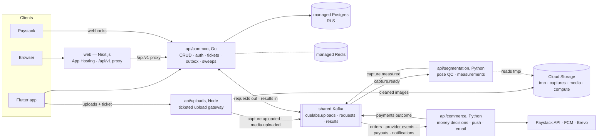
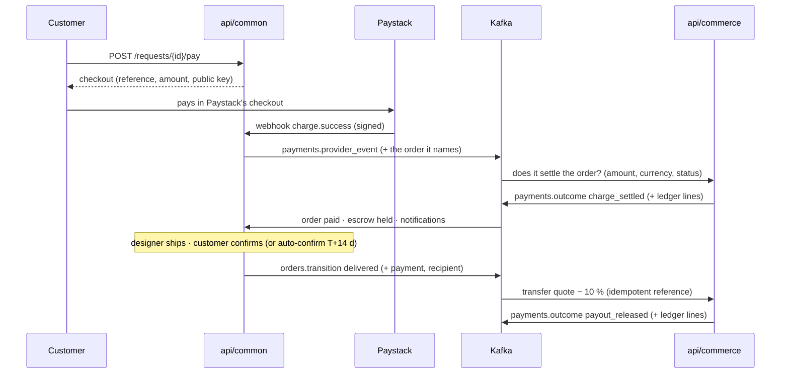
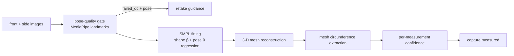

# Apparule — System Architecture

> The system as built, from the ratified [system design](system-design.md)
> (S-1…S-15, decided 2026-10-20). The design holds the reasoning (drivers,
> trade-offs, alternatives); this page is the map. Markers: **[Built]**,
> **[Planned]**.

## 1. Overview **[Built]**



Four services, named by function and split by role (CueLABS language rule):

| Unit | Lang | Role | Owns | Port |
| --- | --- | --- | --- | --- |
| `api/common` | Go | **CRUD** — the whole product API; authorizes every upload; stores every decision | Postgres (sole client); confirmed objects | 8080 |
| `api/segmentation` | Python | **Processing** — per-pose QC and template measurements | nothing | 8081 |
| `api/uploads` | Node (NestJS) | **Thin gateway** — verifies tickets, checks and cleans images, hands off by pointer | nothing | 8082 |
| `api/commerce` | Python | **Processing** — every money decision; push and email delivery | nothing | 8083 |
| `web` | Next.js | Landing, docs hub, dashboard; proxies `/api/v1` | —   | 3000 |
| `mobile/flutter` | Dart | The app (guided two-pose capture, feed, orders) | local cache | —   |

Services talk only through the shared bus (S-2); HTTP between them exists
solely as a data-free `GET /health` wake-up for scale to zero.

## 2. Responsibilities

### 2.1 api/common (Go) **[Built]**

- **Auth** (X-1): Google OAuth sign-in run by common, which signs its own
  session JWT; first sign-in creates the
  account, its personal workspace and self customer (data-model.md §6.1).
- **The product API** the web mock defines (system-design.md §7.3): `/me`,
  consent, the vault, posts, feed and explore (frozen rank snapshots),
  follows, likes, saves, comments, profiles, requests and the order state
  machine, threads, notifications, reports, blocks, moderation, designer
  profile, payout account, earnings, instance requests.
- **Upload authorization** (S-15): consent, ownership, account state, rate
  limits and the 100 MB/day quota are checked before an Ed25519 upload ticket
  exists.
- **Webhooks** (S-12): Paystack signatures verified, raw events stored, handed
  to `commerce`.
- **Outbox** (§6.6) and **consumers** for `capture.uploaded`,
  `media.uploaded`, `capture.measured`, `payments.outcome`.
- **Sweeps** (§6.7, `cmd/jobs`): `captures` (every minute), `orders` and
  `reconcile` (hourly), `retention` (daily).

### 2.2 api/uploads (Node) **[Built]**

One route, `POST /api/v1/uploads`, nothing accepted without a ticket. Reads
exactly the parts the ticket allows, checks type (magic bytes), size and
decodability, re-encodes through sharp (EXIF and GPS gone, ≤ 2048 px), writes
`tmp/`, publishes the pointer. Stateless.

### 2.3 api/segmentation (Python) **[Built]**

Consumes `capture.ready`; runs capture-qc.md §1–§2 on each pose; when both
pass, estimates every measure of the customer's A-10 template with
`mediapipe_2d_v2` and scores it (§3–§4); answers `capture.measured`. Uses the
MediaPipe pose landmarker and selfie segmenter. The SMPL method (§3) arrives
here.

### 2.4 api/commerce (Python) **[Built]**

Decides whether a Paystack charge settles an order, releases payouts
(quote − 10 %) and refunds through the Paystack API, verifies designers' bank
accounts, reconciles the ledger hourly, and delivers notifications (FCM push,
Brevo email for money events, social pushes coalesced). Notify-only without a
Paystack key (self-host).

### 2.5 web (Next.js) **[Built]**

The canonical web tree (web-implementation.md). TEST_MODE runs entirely on
the in-app mock server; otherwise Google sign-in through the API and the `/api/v1` proxy,
which forwards uploads to `api/uploads` and everything else to `api/common`.
Repositories speak the asynchronous flows (create-then-upload, polling,
Paystack checkout) behind unchanged signatures.

### 2.6 mobile/flutter **[Built on fakes; remote repositories planned]**

Feature-first Flutter app (mobile-implementation.md) running on `*Fake`
repositories; the `*Remote` set and the real sign-in (the API's Google
SSO handoff, as the web does) land with the API wave, and push waits on
`flutterfire configure`.

## 3. Core sequences

### 3.1 Capture (two poses) **[Built]**

```mermaid
sequenceDiagram
    actor U as User
    participant C as api/common
    participant G as api/uploads
    participant K as Kafka
    participant P as api/segmentation
    U->>C: POST /me/sessions {input_height_cm}
    C-->>U: 201 session (awaiting_upload) + upload ticket
    U->>G: POST /uploads (image_front, image_side, Upload-Ticket)
    G->>K: capture.uploaded (pointer)
    G-->>U: 202 processing
    K->>C: capture.uploaded → capture.ready (+ template)
    K->>P: capture.ready
    P->>K: capture.measured (measured | failed_qc {code, pose})
    K->>C: store; status pending_save | failed_qc
    loop poll
        U->>C: GET /sessions/{id}
    end
    U->>C: POST /sessions/{id}/save (images tmp/ → captures/, 30 days)
```

A `failed_qc` capture keeps its accepted pose: `POST
/sessions/{id}/poses/{pose}/ticket` retakes only the failing one.

### 3.2 Commission, paid, delivered **[Built]**



## 4. Data

Postgres is the system of record (S-3), read and written only by
`api/common`, with row-level security on private data (S-11). Object storage
holds images: `tmp/` (24 h), `captures/` (30 days after save), `media/`
(published post images), `attachments/` and `exports/` (all served by signed
URLs), `compute/` (claim-check payloads, 1 day). Redis holds rate-limit
windows. See [data-model.md](data-model.md).

## 5. SMPL pipeline — target measurement engine **[Planned, PRD §5]**

SMPL (Skinned Multi-Person Linear model) is a parametric 3-D body model: body
shape is expressed as low-dimensional shape coefficients (β) from which a full
3-D mesh is generated; girths (chest/waist/hip circumference, inseam, etc.) are
then *measured on the mesh*, which is what garment production actually needs.
It lands in `api/segmentation` behind the same events, as `method: smpl_v1`.



- The MediaPipe step stays the quality gate and the fallback method
  (`mediapipe_2d_v2` vs `smpl_v1`, recorded per session).
- Fitting needs GPU inference for the cloud offering (open question 5);
  self-hosters keep the CPU-only 2-D method.
- **Risk R1 — licensing**: SMPL weights are research-licensed; commercial use
  requires a Meshcapade/MPI license. Resolve before the cloud pipeline ships
  (prd.md §8.3, A-3).

## 6. Deployment **[Built]**

- **Cloud** (X-3, X-6): Cloud Run services at min 0 (scale to zero with
  wake-ups), sweeps as Cloud Scheduler POSTs to common, the managed Postgres and Valkey, the shared
  Kafka, Cloud Storage; web on Firebase App Hosting. Tag-gated
  releases. See [deployment.md](deployment.md).
- **Self-host**: `docker-compose.yml` (Postgres, Kafka KRaft, Redis,
  SeaweedFS, the four services, the sweep loop,
  web) and the standard-form Helm chart with CronJobs and an API ingress.

## 7. Cross-repo dependencies

| Dependency | Needed by | Status |
| --- | --- | --- |
| D1 `account.cuesoft.io` facade | future identity facade only | **Not blocking** (X-1): in-app Google sign-in with an API-issued session is the ratified interim; the facade can front the same sign-in later. |
| D2 Monitoring service event-ingestion API | ECO-ANALYTICS | The monitoring service has no generic event endpoint today, tracked in the monitoring service's roadmap. |
| D3 `privacy.cuesoft.io` Apparule clause | APP-005 | Content dependency; page links out. |
| shared Kafka (X-11) | every hand-off | Shared with the sibling products; a sibling product keeps it awake. |
