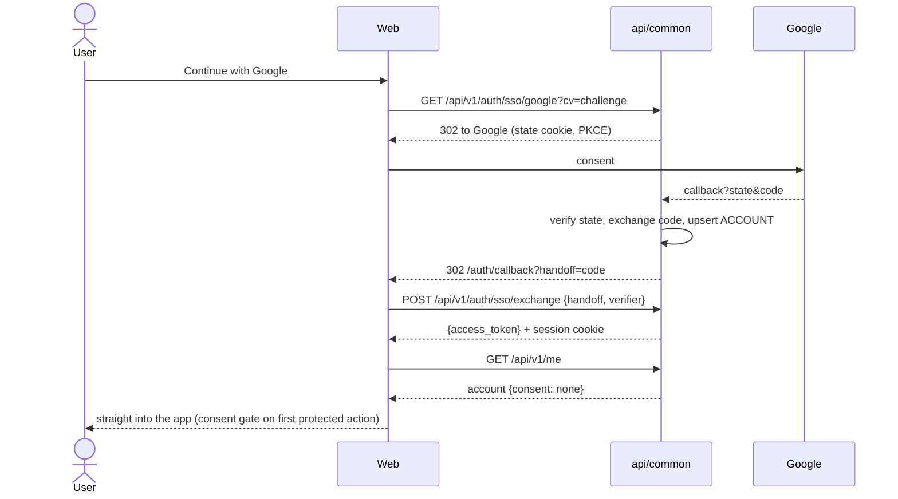

# Flow: Authentication (Google-only, API-issued session)

> Implements decision X-1 as hardened 2026-07-16: **Google sign-in is the
> only authentication method** — no username/password signup or login,
> product-wide. `api/common` runs the Google OAuth code flow and signs its own
> session JWT; the web app only redirects and exchanges a one-time code.

## 1. Hard rule & enforcement

- **Google only.** Enforced at two layers:
  1. Backend: the only sign-in route is the Google OAuth flow; there is no
     password or email endpoint, and a Google account without a verified email
     is rejected;
  2. UI: exactly one auth CTA: "Continue with Google".
- Consequences embraced: no password storage, no reset flow, no credential
  enumeration surface, and `email_verified` is always true (Google-asserted),
  so no separate verification gate exists.

## 2. Session model

- `GET /api/v1/auth/sso/google?cv=<challenge>` starts the flow. `cv` is the
  base64url SHA-256 of a verifier the browser keeps in `sessionStorage`.
  The API stores a server-side state record (10 minute TTL), sets the
  `OAUTH_STATE_COOKIE` and redirects to Google with PKCE (S256).
- `GET /api/v1/auth/sso/google/callback?state=&code=` verifies the state and
  cookie, exchanges the code with Google, upserts the `ACCOUNT` row by Google
  subject (`google_sub`, idempotent; a legacy row is rebound by verified
  email), issues a one-time handoff code and redirects to
  `<WEB_URL>/auth/callback?handoff=<code>`. Failures redirect to
  `/signin?error=<code>`.
- `POST /api/v1/auth/sso/exchange` takes the handoff and the verifier, checks
  them against the stored hash and returns `{ access_token, expires_in }`. The API also sets the
  `SESSION_COOKIE_NAME` cookie (HttpOnly, SameSite) sealed with
  `SESSION_SECRET`. A handoff is single use; a replay is `401 handoff_invalid`.
- API calls send `Authorization: Bearer <JWT>` (HS256, `JWT_SECRET`, lifetime
  `JWT_ACCESS_TTL`) or the session cookie. Cookie requests must come from
  `WEB_URL` (Origin and Fetch Metadata check).
- `POST /api/v1/auth/logout` clears the cookie and ends the session; the web
  client then purges local caches. Unsaved capture drafts warn.
- **Session restore [Decided 2026-07-22, platform-neutral]**: restore
  resolves **before either surface routes**: web calls `GET /api/v1/me` with
  the session cookie before dashboard routes render. A failed restore reads
  as **signed out** (never an error interstitial); a signed-in user never
  sees the auth screen.
- The web app reaches the API through its same-origin `/api/v1` proxy, so the
  state and session cookies are first-party. `GOOGLE_REDIRECT_URI` is the web
  origin's `/api/v1/auth/sso/google/callback` and `WEB_URL` is the web origin.
- The sign-in start is rate limited per source and overall (Redis, with an
  in-memory fallback).

## 3. Sequence (first sign-in)

## 4. Errors & edge cases

| Case | Behaviour |
| --- | --- |
| Consent screen dismissed | redirect to `/signin?error=access_denied`; the sign-in page shows a short notice |
| Expired or reused state | `/signin?error=` with a retry notice; state records are single use |
| Handoff replayed or expired | `401 handoff_invalid`; the callback page offers "Back to sign in" |
| Exchange hits a server error or the network drops | retried with backoff on the same handoff before an error is shown |
| Google account without a verified email | rejected at the callback |
| In-app browsers blocking popups (IG/Twitter webviews) | no popup is used: the flow is full-page redirects |
| Account deletion | blocked while money is in flight: any non-terminal order (either role) or unsettled payout → `409 account_has_active_orders`; otherwise account enters `deletion_pending` (no new social/commerce actions) and hard-deletes ACCOUNT + vault per retention rules, once the last order is terminal and payouts settle |

## 5. Screen inventory impact **[flags removals]**

`login_page` becomes the single auth screen (Google CTA + legal links).
`sign_up_form`, `sign_up_screen`, `forgot_password`, `reset_password`,
`verify_email`, `sms_verification`, `verify_account` are **retired** in the
social redesign (pages.md C1 updates accordingly) — phone verification may
return later for designer KYC, which Paystack owns anyway (A-2).

## 6. Instrumentation & acceptance

Events: `auth_signin_completed`, `auth_signin_failed`, `consent_recorded{document}` (emitted by the consent endpoints, F1-5) — counters only, per the master registry.

- [ ] Handoff replay is rejected with `handoff_invalid` (test with a reused code)
- [ ] Cookie requests from another origin are rejected
- [ ] Sign-in works inside IG/webview browsers (full-page redirects only)
- [ ] Stub endpoints deleted; retired screens removed from the router
- [ ] Exactly one ACCOUNT row under concurrent first-login race
