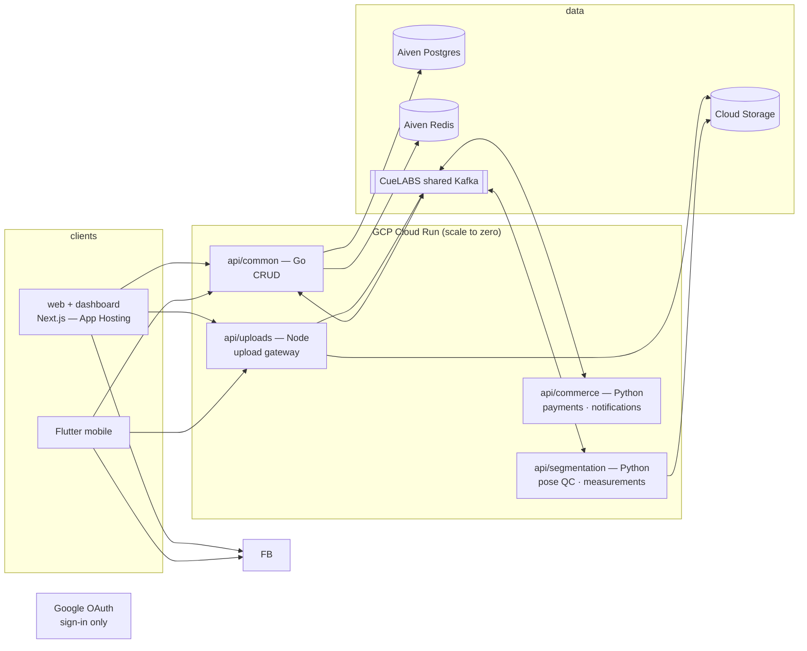

# Overview

Apparule is a fashion body-measurement and social-commerce platform. Users
capture their measurements from their phone, keep them in a private vault,
follow designers, and commission outfits with a frozen copy of their
measurements; designers quote, get paid through escrow, and deliver.

## Architecture

- **`web`** — Next.js marketing site + dashboard (Firebase App Hosting).
- **`mobile`** — Flutter app (iOS/Android): guided two-pose capture, feed, orders.
- **`api/common`** — Go: the product API, the only client of Postgres; authorizes uploads and stores every decision.
- **`api/uploads`** — Node (NestJS): the ticketed upload gateway; strips EXIF and GPS.
- **`api/segmentation`** — Python: per-pose quality checks and measurements (MediaPipe).
- **`api/commerce`** — Python: Paystack money decisions, push and email delivery.
- **Auth**: Google sign-in only (X-1); `api/common` runs the OAuth flow and signs its own session JWT.
- **Data** — Postgres (system of record, S-3), Cloud Storage, shared Aiven Redis, and the CueLABS shared Kafka (X-11).

The [system design](system-design.md) explains why it is shaped this way. See
[setup.md](setup.md) to run the stack locally, and the
[repository structure](https://github.com/cuesoftinc/apparule#repository-structure) in the README.

## Product & design documentation
> Published site: **https://cuesoft.gitbook.io/apparule** (Git-synced from this folder on every merge to main).

- [prd.md](prd.md) — product requirements breakdown (personas, requirements, compliance, open questions)
- [system-design.md](system-design.md) — the ratified system design: services, transports, data ownership, flows
- [architecture.md](architecture.md) — the system as built: services, sequences, SMPL plan
- [data-model.md](data-model.md) — entities, storage mapping, data classification
- [api.md](api.md) — the HTTP surface and conventions
- [roadmap.md](roadmap.md) — phased plan with cross-repo dependencies
- [design.md](design.md) + [pages.md](pages.md) — design language, screens, microinteractions
- [order-lifecycle.md](order-lifecycle.md) — commission order state machine, permissions, notifications
- [decisions.md](decisions.md) — the decision register
- [deployment.md](deployment.md) — Cloud Run + App Hosting contract (IaC provisioning, CI/CD)
- flows/ — feature flow specs with edge cases: [auth](flows/auth.md), [vault](flows/vault.md), [request](flows/request.md), [designer](flows/designer.md)
- [capture-qc.md](capture-qc.md) — QC thresholds + measurement-confidence formulas
- [engineering.md](engineering.md) — error catalog, authz matrix, rate limits, testing strategy, logging rules
- [features.md](features.md) — granular build backlog (stable unit IDs per phase)
