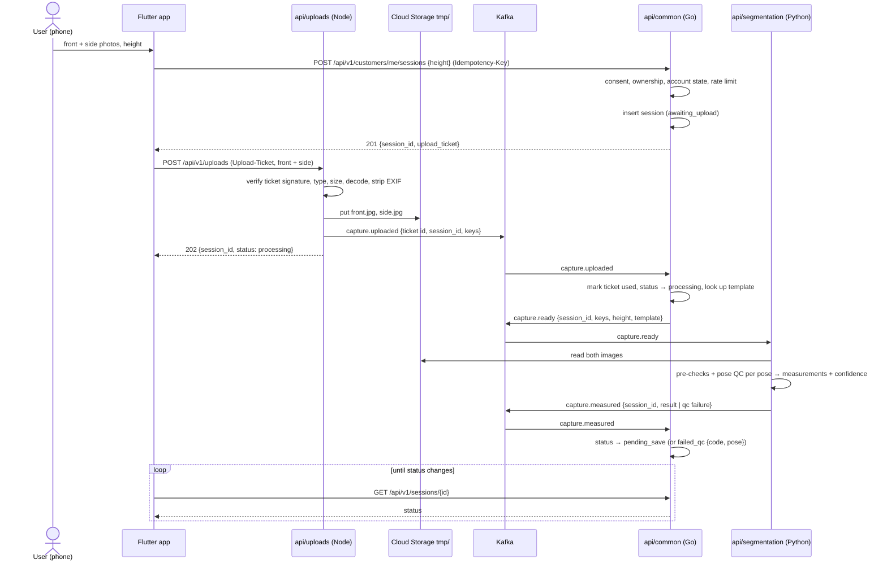

# Apparule — System Design

> **Status: [Proposed] v1 — draft for ratification (2026-09-24).** This
> document replaces the system design described across `architecture.md`
> §1–§3, §6 and §8, `data-model.md` §3, and `deployment.md` §1 and §4 once
> ratified. It keeps every **product** decision in
> [decisions.md](decisions.md) (A-1…A-11, M-*, and X-1…X-10 apart from the
> datastore half of X-5) and every **behavioural** contract in the flow
> docs (vault, request, designer, auth, order lifecycle, capture QC
> thresholds). What it replaces is the **shape of the system**: service
> boundaries, transports, data ownership, and where each piece of work
> runs. New decisions it needs are listed in §13 as **S-1…S-15**. It
> supersedes the earlier "Apparule Pipeline" draft
> (`apparule-pipeline-design.md`), which covered the capture pipeline
> only.
>
> **Language rule (CueLABS standard, applied the same way as Upstat's
> system design):**
> - **Go does CRUD only.** `api/common` owns and persists all data.
> - **Python does all processing:** every decision, such as pose QC,
>   measurements, payout amounts, and whether a payment matches.
> - **The gateway is thin.** It validates and hands off (Node, NestJS).
> - **No serverless functions.** The standard reserves them for probes,
>   and Apparule has none.
>
> Services are named by function and connected through Aiven Kafka.
>
> **Amendment, 2026-10-13: the shared message bus (decisions.md X-11).**
> Apparule's Kafka is the one service shared with Expendit and Upstat, under
> the CueLABS delivery standard's `references/shared-messaging.md`. Where
> this draft says otherwise, the amendment wins:
> - **§5.3:** Apparule's events ride three shared lanes (table below), not
>   ten Apparule topics.
> - **No compacted topics (D6, §6.6, S-8):** measurement templates travel
>   inside `capture.ready`; commerce's ledger view arrives with each
>   `ledger.reconcile_requested` (by pointer), not from `ledger.entries`.
> - **Pointers only:** every payload goes by `data_ref` into Apparule's
>   storage prefix; other products can read the lanes.
> - **Retention is the service's (up to 3 days), not 7 d:** §9.2's "queue
>   in Kafka (7 d)" becomes "re-sent from Postgres": `common` stores what
>   each in-flight request was built from and queues it again, once, when
>   its result is overdue.
> - **Two partitions per lane;** one Kafka user, `apparule`; consumer
>   groups `apparule-<service>`.
> - **Keep-alive:** Expendit owns it; Apparule runs no heartbeat or
>   watchdog, but its gateway must answer 503 cleanly while the bus is away.
> - **Scaling (§10.1, S-9):** consumers may scale to zero with wake-ups
>   (the standard's "Scale to zero" section), as Expendit does; choose that
>   or worker pools when this draft is ratified.

## Contents

1. Why redesign — audit of the current design
2. Design drivers
3. Architecture overview
4. Services
5. Data architecture
6. Key flows
7. API surface
8. Security and tenancy
9. Reliability, failure modes, and capacity
10. Deployment topology
11. Repository layout
12. Doc map — keep, change, retire
13. Decisions to ratify
14. Migration plan
15. Open questions

---

## 1. Why redesign — audit of the current design **[Current docs]**

This audit is of the **documented design** (architecture.md, data-model.md,
deployment.md, api.md, and the flow docs), not the code, which is still a
prototype. The product grew on 2026-07-16 from a measurement tool into a
social-commerce app (prd.md §9), but the system shape stayed the
two-service one it started with.

| # | Finding | Evidence | Consequence |
| --- | --- | --- | --- |
| F1 | **Clients read the database directly.** Firestore was chosen *for* its real-time listeners and offline sync, which means the apps subscribe to the store themselves. | X-5 rationale; engineering.md §6 "Firestore emulator rules tests"; data-model.md §3 | Breaks "one owner per store": `api/common` stops being the only reader, and authorization splits between Go middleware and Firestore security rules. |
| F2 | **Money lives in a store without relational transactions.** The payments ledger, escrow, payouts and refunds need ACID across several rows; X-5 already concedes an "escape hatch" to Postgres for the ledger. | X-5; order-lifecycle.md §3; the money-invariant test (engineering.md §6) | Either two systems of record for one order, or money correctness resting on Firestore transaction limits. |
| F3 | **Counters need a reconciliation job.** Likes, saves and follower counts drift in Firestore's distributed counters, so an hourly job repairs them. | architecture.md §8 J5 | A symptom of F1: work that a relational store does in the same transaction. |
| F4 | **The measurement pipeline is a synchronous internal call.** `common` receives both images, stores them, then calls `api/measure` over HTTP and waits up to 30 s inside the user's request. | architecture.md §4.3, §8; flows/vault.md "Pipeline timeout (>30s)" | A slow or cold `measure` fails the upload. The Go CRUD service handles 20 MB of image bytes per capture. There's no buffer if `measure` is down. |
| F5 | **Go makes decisions.** Payment reconciliation, payout and fee arithmetic, and interpreting Paystack webhooks all sit in `api/common` job entrypoints and handlers. | architecture.md §8 (J4, `/webhooks/payments`) | Breaks the standard, which says Go only does CRUD. |
| F6 | **No gateway.** All uploads (captures, post media, thread attachments) land on the CRUD service. | api.md §2, §5 | The control-plane API and the byte-heavy upload path scale and fail together. |
| F7 | **The pipeline draft gave the gateway a database.** `uploads` wrote a Postgres staging row, and that row had no cleanup path. | Apparule Pipeline artifact, open item 3 | Breaks the standard's "gateway owns no persisted state"; leaves stale rows. |
| F8 | **Kafka consumers on scale-to-zero services.** The runtime table sets `common` and `measure` to min 0; a queue consumer at zero instances never wakes. | deployment.md §4 | The pipeline draft would silently stop once idle. |
| F9 | **The QC contract assumes a synchronous pipeline.** The upload request itself returns `422` per pose. | flows/vault.md §1 step contracts; capture-qc.md | Any queue between upload and QC breaks this contract; it has to be restated as a status. |
| F10 | **The docs disagree with each other.** architecture.md §2 says Flutter may call `measure` directly for self-host; deployment.md §4 says `measure` has no public ingress; A-4 says Postgres, X-5 says Firestore, data-model.md §2 is drawn relationally. Apparule's place as an Upstat customer (events + OTLP) isn't in any system picture. | — | Contributors can't tell which design is current. |

What *is* solid and carries forward: every product decision (A-1…A-11,
M-*, X-1…X-10 except X-5's datastore), the flow docs and order state
machine, the capture-QC thresholds and error codes, the engineering
contracts (error envelope, authorization matrix, rate limits, never-log
list, CORS), the web mock API (already a complete HTTP contract, §7.3),
the CI/CD and tag-gated deploy model (X-6), and the Helm/Terraform
self-host path.

---

## 2. Design drivers

| # | Driver | Design response |
| --- | --- | --- |
| D1 | **Body data is the most sensitive thing we hold.** | Nothing is stored until `common` has authorized it: consent, ownership and account state are checked before a byte is accepted (upload tickets, §6.1). Claim-check: image bytes only ever sit in Cloud Storage, Kafka carries pointers. Temporary images expire in 24 h; confirmed ones after 30 days. Measurement topics keep 24 h. Nothing sensitive is logged (engineering.md §5). |
| D2 | **Language by role** (the standard's pipeline rule). | Go = CRUD (`common`). Python = processing (`segmentation`, `commerce`). Node = thin gateway (`uploads`). |
| D3 | **One owner per store.** | Postgres is read and written only by `api/common`. No client, and no other service, opens it. Go owns the schema. |
| D4 | **Asynchronous between services, with no exceptions.** | Kafka carries every handoff. There are no synchronous internal calls at all; Python services get the reference data they need inside the message or from compacted config topics. No gRPC. |
| D5 | **Money is exact and auditable.** | Ledger in Postgres with ACID transactions; raw provider events stored before anything acts on them; every money decision made in `commerce`, persisted by `common`, and reconciled hourly against Paystack; everything idempotent by provider reference. |
| D6 | **Config flows outward as events.** | `api/common` publishes shared config (measurement templates, QC thresholds version) through a transactional outbox to compacted Kafka topics. |
| D7 | **Users see progress, not a hanging request.** | Every asynchronous step has a status row owned by `common` that the client polls ("keep refreshing"), plus an FCM push when the result is ready. |
| D8 | **Separate fates for separate work.** | Heavy image inference (`segmentation`) and money/notifications (`commerce`) are different services, so a slow model never delays a payout or a push. |
| D9 | **One set of images for cloud and self-host.** | Every managed dependency has a single-container self-host equivalent (Postgres, Kafka KRaft, Redis, MinIO for Cloud Storage). |

---

## 3. Architecture overview

```mermaid
flowchart LR
    subgraph Clients
        APP[Flutter app]
        BR[Browser]
        PS[Paystack]
    end

    subgraph Edge
        WEB[web — Next.js<br/>App Hosting + CDN]
        LB{{HTTPS load balancer<br/>api.apparule.cuesoft.io}}
    end

    COMMON[api/common — Go<br/>CRUD · auth · feed · orders · outbox · sweeps]
    UP[api/uploads — Node<br/>thin gateway]

    subgraph Python — processing
        SEG[api/segmentation — Python<br/>pose QC · measurements]
        COM[api/commerce — Python<br/>payouts · refunds · reconciliation · notify]
    end

    PG[(Aiven Postgres)]
    GCS[(Cloud Storage)]
    R[(Aiven Redis)]
    K[[Aiven Kafka]]
    UPS[Upstat<br/>events + OTLP]
    EXT[Paystack API · FCM · Brevo]

    APP --> LB
    BR --> WEB
    BR --> LB
    WEB -->|SSR| LB
    PS -->|webhooks| LB
    LB -->|/api/v1/* default| COMMON
    LB -->|/api/v1/uploads + ticket| UP

    UP -->|temp images| GCS
    UP -->|pointers| K
    COMMON --> PG
    COMMON -->|move on save| GCS
    COMMON -->|config · ready · transitions| K
    K -->|results · outcomes| COMMON
    K -->|capture ready| SEG -->|measured| K
    SEG -.->|read temp images| GCS
    K -->|transitions · provider events · notifications| COM -->|outcomes| K
    COM --> EXT
    COMMON -.- R
    COMMON & UP & SEG & COM -.->|OTLP/HTTP · events| UPS
```

---

## 4. Services

Four deployables we write (web, one Go, one Node, two Python). Ports follow
the standard: `api/common` 8080, then each service in the order it was
added. `segmentation` is today's `measure` renamed, so it keeps 8081.
(The pipeline draft numbered these differently; this supersedes it.)

| Unit | Lang | Role | Responsibility | Owns | Port |
| --- | --- | --- | --- | --- | --- |
| `web` | Next.js | Frontend | Landing, docs hub, `/docs/api`, dashboard (feed, vault, requests, designer workspace, moderation) | — | 3000 |
| `api/common` | **Go** | **CRUD** | The whole product API: Firebase auth, accounts, workspaces, customers, consent, instance requests, vault and sessions, posts, follows, likes, saves, comments, feed and explore queries, requests and the order state machine's user-driven transitions, threads, reports and blocks, notification rows, exports. **Authorizes every upload** and issues a signed upload ticket for it, counting the bytes it authorizes against the daily upload quota (§6.1). **Receives Paystack webhooks** (verify signature, store raw event). **Outbox publisher.** **Scheduled sweeps** (lookup-then-write: quote expiry, auto-confirm, escrow timeout, retention purge). Persists every decision Python makes. | **Postgres** (sole client), Cloud Storage confirmed prefixes | 8080 |
| `api/segmentation` | **Python** | Processing | Per-pose image pre-checks and pose QC (capture-qc.md), measurement extraction against the customer's A-10 template, per-measurement confidence. MediaPipe 2-D today; SMPL at Phase E. | nothing; reads temp images, emits via Kafka | 8081 |
| `api/uploads` | **Node** (NestJS) | Thin gateway | Capture photos (front + side), post media, thread attachments: verifies the upload ticket `common` issued (public key, no call), type/size/decode checks against the ticket's limits, EXIF and GPS stripping, write to temporary Cloud Storage, pointer → Kafka. Stateless. | nothing: no database, no Redis, only `common`'s public keys | 8082 |
| `api/commerce` | **Python** | Processing | **Money:** interprets Paystack events (does this charge settle order X for amount Y?), computes payout = quote − 10 % fee, executes transfers and refunds through the Paystack API, reconciles the ledger against Paystack hourly. **Notify:** delivers push (FCM) and money emails (Brevo) for every notification row `common` writes. | nothing; its view of the ledger comes from Kafka | 8083 |

**Retired:** the synchronous `common → measure` HTTP call and its Cloud Run
IAM wiring; `/measure` as a public endpoint in cloud; the counter
reconciliation job (J5); the Firestore data layer and security rules; the
pipeline draft's Postgres staging table.

**Why these boundaries.**
- **`uploads` is separate from `common`** so 20 MB of image bytes per
  capture never queue in front of, or starve, the product API, and so
  the API can be scaled without scaling the upload path.
- **`commerce` is separate from `segmentation`** because a slow model,
  a cold 2 GiB instance or (later) a GPU queue must never delay a payout,
  a refund or an "order funded" push.
- **Notifications ride in `commerce`** because most push-worthy events are
  order transitions (order-lifecycle.md §4). Social pushes (likes, follows,
  comments) are batched and low-priority in the same consumer.
- **Feed ranking stays in `common`** for now. v1 ranking is recency plus
  follow affinity plus a proximity tier (api.md §5), which is an `ORDER BY`
  over data Go owns. When ranking becomes a model, it moves to Python
  (S-10).

---

## 5. Data architecture

### 5.1 Stores and ownership

| Store | Holds | Written by | Read by | Source of truth? |
| --- | --- | --- | --- | --- |
| **Aiven Postgres** | Every domain entity (data-model.md §2, §5, §6) + ledger + raw provider events + outbox | `api/common` | `api/common` | Yes |
| **Cloud Storage** `apparule/<env>/tmp/…` | Uploaded images before a decision | `uploads` | `segmentation` (captures), `common` (to move) | No; 24 h lifecycle rule deletes leftovers |
| **Cloud Storage** `apparule/<env>/{captures,media,attachments,exports}/…` | Confirmed capture images (30-day retention), post media, thread attachments, exports | `common` (moves from `tmp/`) | `common` (signed URLs) | Yes, for blobs |
| **Aiven Kafka** | Handoffs + compacted config (§5.3) | per topic | per topic | No; a durable buffer. Config topics rebuild from Postgres. |
| **Aiven Redis** (`REDIS_DB` index, X-5) | Per-account rate limits (engineering.md §3) and the daily upload quota (100 MB/day/account, counted when tickets are issued) | `common` | `common` | No. Losing it is survivable (§9.2). |

`uploads`, `segmentation` and `commerce` use no Redis and no database.
The gateway is stateless; the two Python services keep only in-memory
state rebuilt from Kafka on start.

### 5.2 Postgres

The entity model in data-model.md §2, §5 and §6 is already relational and
moves over unchanged; only the storage mapping (data-model.md §3) is
rewritten. Additions this design needs:

| Table | Why |
| --- | --- |
| `measurement_session.status` gains `awaiting_upload`, `processing`, `failed_qc` (with `qc_code`, `qc_pose`) | The polled status for asynchronous capture (§6.1) |
| `measurement_session.idempotency_key` (unique per account) | A retried create returns the same session and a fresh ticket, never a second session |
| `upload_ticket` (`jti`, `session_id` or media owner, `poses`, `expires_at`, `used_at`) | Single use: `common` marks a ticket used when its `capture.uploaded` arrives and ignores repeats |
| `provider_event` (`provider`, `provider_event_id` unique, `payload`, `received_at`, `processed_at`) | Every Paystack webhook is stored before anything acts on it (D5) |
| `ledger_entry` (append-only, double-entry: `escrow`, `platform_fee`, `designer_payable`, `refund`) | The money invariant becomes a SQL constraint and a property test |
| `outbox` (`topic`, `key`, `payload`, `created_at`, `published_at`) | Transactional outbox (§6.6) |

Counters (`like_count`, `save_count`, `follower_count`) are updated in the
same transaction as the row that changes them, so they cannot drift and
need no reconciliation job. Tenancy is enforced with row-level security
keyed on `account_id` and `workspace_id` (S-11).

### 5.3 Kafka events (on the shared bus)

Apparule uses the CueLABS shared message bus (decisions.md X-11; the
standard's `shared-messaging.md` is the source of lanes, envelope, limits
and operations). This table lists only Apparule's events. Messages are JSON
envelopes validated against JSON Schemas in `api/common/contract/`; every
payload travels by pointer.

| Event | Lane | Key | Producer → consumers |
| --- | --- | --- | --- |
| `apparule.capture.uploaded` | `cuelabs.uploads` | session id | uploads → common |
| `apparule.media.uploaded` | `cuelabs.uploads` | owner id | uploads → common |
| `apparule.capture.ready` | `cuelabs.requests` | session id | common (outbox) → segmentation; carries the customer's measurement template |
| `apparule.orders.transition` | `cuelabs.requests` | request id | common (outbox) → commerce |
| `apparule.payments.provider_event` | `cuelabs.requests` | provider event id | common (outbox) → commerce |
| `apparule.ledger.reconcile_requested` | `cuelabs.requests` | `reconcile` | common's hourly job → commerce; carries the ledger slice to reconcile |
| `apparule.notifications.created` | `cuelabs.requests` | account id | common (outbox) → commerce |
| `apparule.capture.measured` | `cuelabs.results` | session id | segmentation → common |
| `apparule.payments.outcome` | `cuelabs.results` | request id | commerce → common |

Measurement values never appear on the bus: `capture.measured` points at
an object under Apparule's storage prefix that only `common` can read.

---

## 6. Key flows

### 6.1 One capture, two poses



- **`common` authorizes before anything is stored.** Consent, customer
  or workspace ownership, blocked or deletion-pending accounts, and the
  capture rate limit (engineering.md §3) are all checked when the session
  is created, before the app sends a single photo. Without consent the
  capture stays on the phone as a local draft (flows/vault.md), so no body
  image ever reaches our storage unconsented.
- **The upload ticket.** A short-lived token (5 minutes) that `common`
  signs with its private key (Ed25519). Its claims are the account, the
  session, the poses allowed, the maximum bytes per image and a unique
  `jti`. The gateway verifies it with `common`'s public key: no call to
  `common`, no database, and the gateway never holds a key that can mint
  tickets. It's single use: `common` marks the `jti` used when it consumes
  `capture.uploaded` and ignores repeats.
- **Retake one pose.** On `failed_qc`, the app asks `common` for a ticket
  scoped to the failing pose (`POST /api/v1/sessions/{id}/poses/{front|side}/ticket`)
  and uploads only that image. The accepted pose's temp image is reused,
  so an accepted pose is never discarded (flows/vault.md), and a retake
  ticket can't replace the other pose.
- **Post media and thread attachments** use the same pattern:
  `POST /api/v1/media/tickets` (only a KYC-complete designer can get a
  post-media ticket) and `POST /api/v1/requests/{id}/attachments/tickets`
  (only a party to that order).
- **Validation stays synchronous.** The gateway still answers `422`
  immediately for `undecodable_image`, unsupported type and oversize files,
  naming the pose. Everything that needs the model (`no_body`,
  `partial_body`, `not_frontal`, …) arrives as `failed_qc`.
- **Timeouts.** A session still `awaiting_upload` after its ticket
  expires is deleted by the sweep. A session still `processing` after 60 s
  is marked `failed` with `pipeline_busy`, and the client offers a retry
  with a new idempotency key.
- **Push.** When the session reaches `pending_save`, `common` writes a
  notification row, and `commerce` sends a silent push so a backgrounded
  app refreshes without waiting for the next poll.

### 6.2 Save, promote, expire

On **Save**, `common` moves both images from `tmp/` to `captures/`,
sets `retention_until` to 30 days, and flips the session to `complete`,
all in one request. **Retake** deletes the session and its temp objects.
A session never saved is purged by the daily sweep after 24 h; the
temp objects are already gone by the bucket's lifecycle rule. There is no
staging row to clean up.

### 6.3 Commission paid, delivered, paid out

```mermaid
sequenceDiagram
    participant PS as Paystack
    participant C as api/common (Go)
    participant K as Kafka
    participant M as api/commerce (Python)

    PS->>C: webhook charge.success (signed)
    C->>C: verify signature, insert provider_event (idempotent)
    C-->>PS: 200
    C->>K: payments.provider_events
    K->>M: provider event
    M->>M: match reference → order, amount, currency
    M->>K: payments.outcomes {request_id, paid, ledger lines}
    K->>C: outcome
    C->>C: order quoted → paid, ledger: escrow held, notification rows
    Note over C: … designer ships; customer confirms or auto-confirm at T+14 d …
    C->>K: orders.transitions {delivered, quote, payout recipient}
    K->>M: delivered
    M->>M: payout = quote − 10 % fee
    M->>PS: Transfers API (idempotency = request id)
    M->>K: payments.outcomes {payout released, ledger lines}
    K->>C: outcome
    C->>C: ledger: fee + payout, PAYOUT released, notification rows
```

Refunds follow the same path from a `refunded` transition. Every Paystack
call carries the request id as its idempotency reference, so a consumer
restart can never pay twice.

### 6.4 Reconciliation

Hourly, a Cloud Run job from the `commerce` image lists Paystack
transactions and transfers for the window, compares them with its
compacted view of `ledger.entries`, and emits a `payments.outcomes`
message of kind `mismatch` for anything that disagrees. `common` stores
it and raises an ops alert; a human resolves it. `commerce` never "fixes"
the ledger on its own.

### 6.5 Notifications

`common` writes the `NOTIFICATION` row in the same transaction as the
event that causes it (the row is the source of truth, data-model.md
§6.4), and the outbox publishes `notifications.created`. `commerce` sends
FCM push for everything in order-lifecycle.md §4, and Brevo email for
money events only. Social pushes are coalesced (e.g. "12 new likes") on a
5-minute window. Delivery is best-effort; the in-app activity sheet reads
rows from `common`.

### 6.6 Config propagation (outbox)

A `common` write and its outbox row commit in one transaction. The
publisher (every instance, `SKIP LOCKED` batches) sends rows to Kafka and
stamps `published_at`. `segmentation` rebuilds its template map from
offset 0 of `config.templates` on start; `commerce` rebuilds its ledger
view from `ledger.entries`.

### 6.7 Scheduled sweeps

Cloud Scheduler triggers Cloud Run jobs (architecture.md §8 kept, with
new owners):

| Job | Image | Cadence | Kind |
| --- | --- | --- | --- |
| Quote expiry (7 d) | common | hourly | lookup-then-write |
| Auto-confirm + reminders (T+7, T+12, T+14) | common | daily | lookup-then-write |
| Escrow timeout (paid, not started at T+14 d → refunded) | common | hourly | lookup-then-write; `commerce` executes the refund |
| Retention purge (unsaved sessions 24 h, capture images 30 d, threads 30 d after terminal) | common | daily | lookup-then-write |
| Stuck sessions (`processing` > 60 s → `failed`; `awaiting_upload` past ticket expiry → deleted) | common | every minute | lookup-then-write |
| Payment reconciliation | commerce | hourly | decision (§6.4) |

Counter reconciliation (J5) retires (§5.2).

---

## 7. API surface

### 7.1 Hosts

| Host | Routes to | Protocol |
| --- | --- | --- |
| `apparule.cuesoft.io` | web | HTTPS |
| `api.apparule.cuesoft.io` | common (default, including session creation and every `…/ticket` endpoint); uploads for `POST /api/v1/uploads` only | HTTP/JSON; multipart with an `Upload-Ticket` header |
| `api.apparule.cuesoft.io/webhooks/payments` | common | HTTPS, Paystack-signed |

The gateway has exactly one public route, and it accepts nothing without a
ticket from `common`. `segmentation` and `commerce` have **no ingress** at
all.

### 7.2 Protocol stance

HTTP/JSON everywhere (X-8: Apparule never adopts gRPC). Kafka between
services. No synchronous service-to-service calls.

### 7.3 The web mock server *is* the contract

`web/src/app/api/mock/v1/**` plus the web models already specify, and
test, the HTTP API the dashboard and app need. The backend implements that
contract; it does not redesign it:

1. Generate `docs/api/openapi.yaml` from those routes and models. It
   becomes the source for Scalar (`/docs/api`) and for request validation
   in `common` and `uploads`.
2. **Contract tests:** run the web's controller and model suites with the
   API base pointed at a compose stack, next to the mock. Divergence fails
   CI.
3. Change the mock once, for §6.1. Creating a session takes JSON only and
   returns `201 {session_id, upload_ticket}`; the photos go to
   `POST /api/v1/uploads`, which returns `202`; the session gains
   `awaiting_upload`, `processing` and `failed_qc`; retakes, post media
   and attachments get `…/ticket` endpoints. These are the only contract
   changes this design needs, and they all come from uploads.
4. Cut the web and app over surface by surface; TEST_MODE and the mock
   stay, as the web and mobile standards require.

Error envelope, pagination, idempotency keys and CORS follow
engineering.md unchanged.

---

## 8. Security and tenancy

| Concern | Control |
| --- | --- |
| **User auth** | Firebase ID tokens, Google provider only (`provider_not_allowed` otherwise, X-1), verified in `common` (Go) against Google's public keys. The gateway doesn't need them: it accepts only upload tickets. No shared `JWT_SECRET`. |
| **Authz** | engineering.md §2 matrix as a capability table in `common`, applied **before** any upload: `common` issues an upload ticket only after checking consent, ownership, account state and rate limits. The gateway verifies the ticket's signature, expiry and limits with `common`'s public key, and cannot mint tickets itself. Tickets are single use (`jti`). |
| **Tenancy** | `account_id` / `workspace_id` everywhere; Postgres row-level security as defence in depth. Cross-account access returns `not_found`. No role ever reads another account's vault. |
| **Machine identity** | Kafka ACLs: one SASL user per service with topic-level grants (only `common` can read `capture.measured`; only `commerce` can read `payments.*`). Cloud Storage IAM per prefix: `uploads` write-only on `tmp/`, `segmentation` read-only on `tmp/`, `common` read/write on everything. |
| **Money** | Paystack signature verified before storing; raw events stored before acting; all provider calls idempotent by request id; the Paystack secret key lives only in `common` (webhook HMAC) and `commerce` (API calls). |
| **Privacy** | EXIF and GPS stripped at the gateway before the image touches storage. Measurement values only on one 24 h, single-reader topic. Never-log list (engineering.md §5) applies to all four services and both telemetry pipelines, CI-grep-gated. |
| **Secrets** | Doppler `apparule/stg` → Cloud Run env. Per-service, least-privilege credentials for Kafka, Postgres and Redis. The ticket-signing private key lives only in `common`; `uploads` gets the public key. Rotation publishes the new public key first, keeps both for one ticket lifetime, then retires the old one. |
| **Abuse** | Every limit is enforced in `common` before a ticket exists: engineering.md §3 rate limits and the 100 MB/day upload quota. The ticket carries the byte and image limits (10 MB per image, 2 images per capture), and the gateway rejects anything without a valid ticket after a signature check, before reading the body. |

---

## 9. Reliability, failure modes, and capacity

### 9.1 SLOs **[Proposed]**

| SLO | Target |
| --- | --- |
| Product API availability (`common`) | 99.5 % monthly |
| Capture time-to-result (upload `202` → `pending_save` / `failed_qc`) | p95 ≤ 15 s |
| Payment confirmed after Paystack webhook | p95 ≤ 60 s |
| Refund issued after the resolving event | ≤ 1 business day (order-lifecycle.md §3) |
| Ledger mismatches unresolved > 24 h | 0 |

### 9.2 Failure modes

| Failure | What happens |
| --- | --- |
| `segmentation` down or slow | Uploads still succeed; sessions wait in `processing` and drain when it returns. Past 60 s the sweep marks them `pipeline_busy`. |
| `commerce` down | Orders still move; money outcomes and pushes queue in Kafka (7 d) and apply when it returns. Webhooks are already stored in Postgres. |
| `common` down | Product API down, and no new uploads start (no tickets). Uploads with a ticket already issued still land in `tmp/` and queue; webhooks fail and Paystack retries. |
| Kafka down | `uploads` returns `503` (it can't hand off); `common` keeps serving and the outbox holds everything until Kafka returns. |
| Redis down | Rate limits and the upload quota in `common` fail open for at most the outage; the gateway doesn't notice. Idempotency and single-use tickets are enforced in Postgres, so nothing duplicates. |
| Cloud Storage down | Uploads return `503`; nothing else is affected. |
| A consumer crashes mid-message | At-least-once delivery; every consumer is idempotent by key (session id, provider event id, request id). |

### 9.3 Who watches Apparule

Upstat (Apparule is one of its first-party customers, X-9): uptime checks
on `api.apparule.cuesoft.io/health` and the web; OTLP traces, logs and
metrics from all four services; alerts on consumer lag for
`capture.ready` and `payments.*`; product events (flows' instrumentation
sections) to `/v1/events`.

### 9.4 Capacity sketch

Images are compressed on the client to ≤ 2048 px (~0.5–1.5 MB each), so a
capture is ~3 MB. At 1,000 captures a day that's ~3 GB/day into `tmp/`,
all deleted within 24 h. `segmentation` on MediaPipe needs ~1–2 s of CPU
per pose, so one 2-vCPU worker handles ~1,000 captures an hour. Kafka
volume is negligible (pointers and small JSON).

---

## 10. Deployment topology

### 10.1 Cloud (X-3, X-6: tag-gated, `stg` only)

| Unit | Cloud Run kind | Scaling |
| --- | --- | --- |
| web | Firebase App Hosting | managed |
| api/common (Go) | Service | **min 1** (Kafka consumer + outbox publisher), max 5 |
| api/uploads (Node) | Service | 0–5 |
| api/segmentation (Python) | **Worker pool**, 2 vCPU / 2 GiB | 1–3 (Kafka autoscaler on lag) |
| api/commerce (Python) | **Worker pool** | 1–2 |
| Sweeps (§6.7) | Cloud Run jobs + Cloud Scheduler | per job |
| Postgres, Redis, Kafka | Aiven, GCP us-central1 | — |
| Cloud Storage | default bucket, `apparule/<env>/…`, lifecycle rule on `tmp/` | — |

Worker pools are the primitive for Kafka consumers: no request timeout and
no scale-to-zero that would stop consumption. An external HTTPS load
balancer with serverless NEGs does the path routing in §7.1.
Provisioning goes through cuesoft-iac.

### 10.2 Self-host (compose + Helm)

Compose runs `postgres`, `kafka` (Apache Kafka, KRaft, single node),
`redis`, `minio` (S3-compatible stand-in for Cloud Storage, with the same
24 h lifecycle on `tmp/`), and the four app services. Helm uses the same
images; stateful dependencies are external endpoints or opt-in subcharts.
Self-hosters without Paystack run with `commerce` in notify-only mode.

### 10.3 Environment variables (fleet names only)

`DATABASE_URL` · `REDIS_HOST/PORT/USERNAME/PASSWORD/TLS/DB` ·
`KAFKA_BROKERS/USERNAME/PASSWORD/SSL_CA` · `FIREBASE_PROJECT_ID` ·
`STORAGE_BUCKET` · `PAYSTACK_SECRET_KEY` (common, commerce) ·
`UPLOAD_TICKET_PRIVATE_KEY` (common) · `UPLOAD_TICKET_PUBLIC_KEYS` (uploads; a list, for rotation) ·
`BREVO_API_KEY/FROM_EMAIL/FROM_NAME` (commerce) · `OTEL_*` ·
`CORS_ORIGINS`.

Retired: `JWT_SECRET`, `FIREBASE_CONFIG_PATH` (ADC on Cloud Run),
`MEASURE_URL`.

---

## 11. Repository layout (target)

```
api/
  common/          Go — CRUD owner (module github.com/cuesoftinc/apparule/api/common)
    cmd/{server,jobs}/
    internal/{config,handler,middleware,model,repository,service,router,outbox,consumer,sweep}
    migrations/    Go owns the schema
    contract/      JSON Schemas for every Kafka message (Go, Python, Node validate against them)
  uploads/         Node (NestJS) — src/{health,upload,ticket,image,storage}
  segmentation/    Python (FastAPI shell + consumer) — was api/measure; qc/, pose/, measurement/
  commerce/        Python (FastAPI shell + consumers) — payments/, payouts/, reconcile/, notify/{fcm,brevo}
deploy/{docker,helm,terraform}
web/
mobile/flutter/
docs/
```

---

## 12. Doc map — keep, change, retire

| Doc | Fate |
| --- | --- |
| prd.md, pages.md, design.md, features.md, roadmap.md (phase content) | **Keep** |
| flows/auth.md, flows/request.md, flows/designer.md, order-lifecycle.md | **Keep**; behaviour unchanged |
| flows/vault.md §1 step contracts, capture-qc.md response shape | **Change**: `202` + polled status; per-pose QC via `failed_qc` (§6.1). Thresholds and codes unchanged |
| engineering.md §1–§5, CORS, telemetry | **Keep**; §6 "Firestore emulator rules tests" → Postgres RLS tests |
| data-model.md §2, §5, §6 | **Keep** entities; add §5.2 columns and tables |
| data-model.md §3, architecture.md §1–§3, §6, §8, deployment.md §1, §4, api.md §2 (measure contract) | **Rewrite** from this document on ratification |
| decisions.md X-5 (datastore half), A-4 revision note | **Update** per S-3 |
| apparule-pipeline-design.md (local draft) | **Retire**; superseded by this document |

---

## 13. Decisions to ratify

| ID | Decision | Supersedes | Recommendation |
| --- | --- | --- | --- |
| **S-1** | Units: web · `api/common` (Go, CRUD) · `api/uploads` (Node, gateway) · `api/segmentation` (Python, was `measure`) · `api/commerce` (Python) | architecture.md §2–§3, deployment.md §1 | ⭐ ratify |
| **S-2** | **Aiven Kafka** between services; no synchronous internal calls | architecture.md §2 "internal call", §8 s2s IAM | ⭐ ratify (chosen 2026-09-24) |
| **S-3** | **Postgres (Aiven) is the system of record**, `api/common` its only client. Real-time via FCM push + polling; offline via a local cache in the Flutter app. Keeps X-5's Firebase Auth, Redis, Doppler and Cloud Storage parts | X-5 datastore (Firestore); restores A-4 | ⭐ ratify; needs explicit sign-off as a reversal of X-5 |
| **S-4** | **Asynchronous capture**: create the session on `common`, upload with a ticket, `202` + polled status; `failed_qc {code, pose}`; per-pose retake ticket; file checks stay synchronous at the gateway | flows/vault.md §1, capture-qc.md response, api.md measure contract | ⭐ ratify |
| **S-5** | **Claim-check**: bytes only in Cloud Storage `tmp/` (24 h lifecycle), pointers on Kafka, `common` moves on save | pipeline draft's staging table | ⭐ ratify |
| **S-6** | **Money decisions in `api/commerce`**: provider-event matching, fee and payout arithmetic, transfers and refunds, reconciliation. `common` persists | architecture.md §8 J4 + webhook handling in common | ⭐ ratify |
| **S-7** | **Notification delivery in `api/commerce`** (FCM, Brevo); `common` writes the rows | architecture.md §8 "common → FCM" | ⭐ ratify |
| **S-8** | Config and ledger propagate by **transactional outbox**, compacted topics | — | ⭐ ratify |
| **S-9** | **Worker pools** for `segmentation` and `commerce`; `common` min 1; sweeps as Cloud Run jobs | deployment.md §4 (all min 0) | ⭐ ratify; note the always-on cost against the free tier |
| **S-10** | Counter reconciliation retires (transactional counters). Feed ranking stays SQL in `common` until it becomes a model, then moves to Python | architecture.md §8 J5 | ⭐ ratify |
| **S-11** | Tenancy defence in depth: Postgres RLS; per-prefix Storage IAM; per-service Kafka ACLs | engineering.md §6 Firestore rules | ⭐ ratify |
| **S-12** | Paystack webhooks land on `common` (verify + store raw + outbox); interpretation in `commerce` | — | ⭐ ratify |
| **S-13** | Topic names `apparule.<domain>.<event>` on the shared Kafka service | pipeline draft's `apparule.uploaded/ready/processed` | ⭐ ratify; propose the same scheme to Expendit |
| **S-14** | Ports: common 8080, segmentation 8081 (keeps `measure`'s), uploads 8082, commerce 8083 | pipeline draft (uploads 8081, segmentation 8082) | ⭐ ratify |
| **S-15** | **Upload tickets**: `common` authorizes every upload first and issues a single-use, 5-minute ticket signed with its private key (Ed25519); the gateway verifies it with the public key and accepts nothing without one. The gateway is stateless (no database, no Redis); all limits and quotas are enforced in `common` | the pipeline draft's gateway, which stored images before any authorization | ⭐ ratify; propose the pattern to Expendit's `statements` gateway (replaces its shared `JWT_SECRET`) |

On ratification: record S-1…S-15 in decisions.md, update
`.cuelabs/project.yaml` (`backend: {common, segmentation, uploads,
commerce}`), update the standard's `repository-and-services.md`
multi-service example list ("e.g. expendit's statements/analytics,
apparule's uploads/segmentation/commerce"), and rewrite the docs in §12.

---

## 14. Migration plan

No production data exists (X-6), so there is no data migration. Phases
follow the roadmap's revised order; each ships behind the web's
per-surface API-base flip, so the mock keeps serving anything not yet
real.

| Phase | Delivers | Exit criteria | Maps to |
| --- | --- | --- | --- |
| **A. Foundations** | Provision Postgres, Kafka, Redis (cloud + compose); `common` on Postgres: Firebase auth, consent, instance requests, outbox, migrations, contract tests | Auth, consent and instance-request surfaces run against real `common`; contract suite green for them | Roadmap P1 |
| **B. Vault + capture** | `uploads`; `measure` → `segmentation` as a Kafka worker with per-pose QC and A-10 templates; capture topics; polling UI on web and app; save/retake; sweeps for stuck and unsaved sessions | capture → QC fail → retake one pose → save, on both surfaces; retention jobs live | Roadmap P2 |
| **C. Social** | Post media and attachments through `uploads`; feed/explore SQL ranking; follows, likes, saves, comments with transactional counters; reports and blocks; notification rows + `commerce` notify-only (FCM) | post → follow → feed → like/comment E2E with T&S actions; pushes arrive | Roadmap P3 |
| **D. Commerce** | Webhook receiver, `provider_event`, ledger; `commerce` money consumers; escrow timeout, quote expiry, auto-confirm sweeps; reconciliation job | request → quote → pay → deliver → payout on Paystack sandbox; money invariant property test green; disputes freeze payouts | Roadmap P4 |
| **E. SMPL** | `segmentation` v2 (fitting, mesh girths) on GPU | Accuracy report published; cloud girth sessions selectable | Roadmap P5 |

---

## 15. Open questions

1. **Kafka that powers off when idle.** *Answered 2026-10-13 (X-11): the
   shared Kafka powers off when idle and Expendit's reaper keeps it alive;
   see the amendment at the top.* Original question: the shared Kafka powers off when idle,
   and this design has always-on consumers. Is the shared Kafka service on
   a paid plan (it's also Upstat's S-2 dependency), or does Apparule wait
   for it?
2. **Self-host `/measure`.** Should `segmentation` keep a synchronous
   `POST /measure` for self-hosters who only want the measuring engine,
   without Kafka? It would sit behind a flag and be off in cloud.
3. **Offline scope in the Flutter app.** Which screens must work offline
   (vault read-only? drafts only?) now that Firestore's sync is gone.
4. **Exports.** PDF/CSV generation is formatting, not a decision, so it
   stays in `common` for now. Move to a job if generation gets slow.
5. **GPU for SMPL (Phase E).** Cloud Run GPU worker pool or a GKE node
   pool; decide with the licensing outcome (A-3).
6. **Shared Postgres.** Can Expendit and Apparule share one Aiven Postgres
   service (two logical databases) within Aiven's plan limits?
7. **Consent of a shop's customers.** Consent is recorded per account and
   per document version (`CONSENT_RECORD`, data-model.md §2). When a tailor
   shop captures one of *its* customers (`CUSTOMER.kind = client`), the
   person in the photos isn't the account holder, and nothing records
   their consent. This needs a product and legal answer: for example a
   per-customer consent record the shop attests to, or the customer
   confirming by link. Whatever is chosen, `common` checks it when it
   issues the upload ticket for that customer's session.
